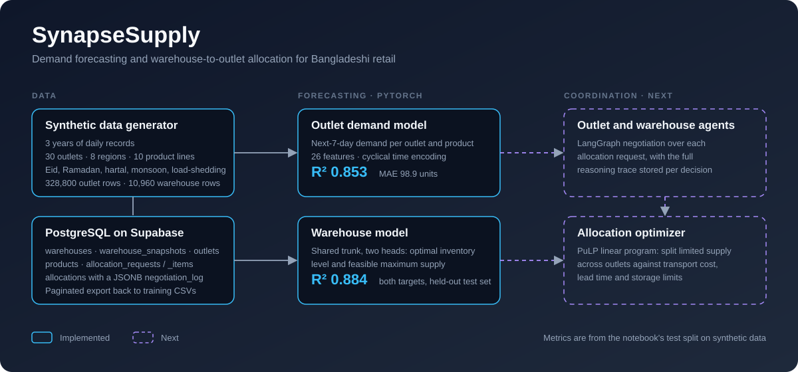
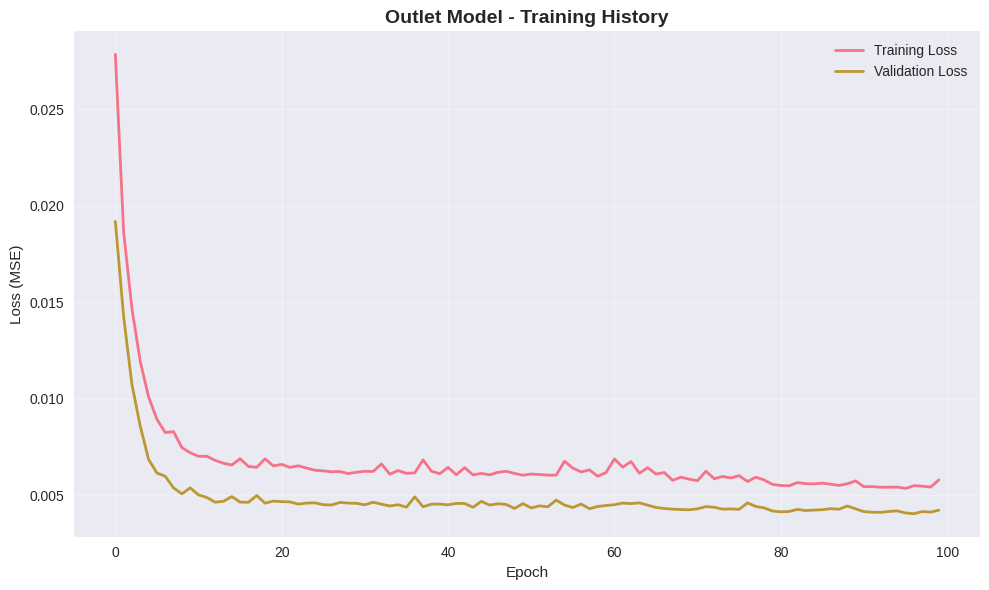
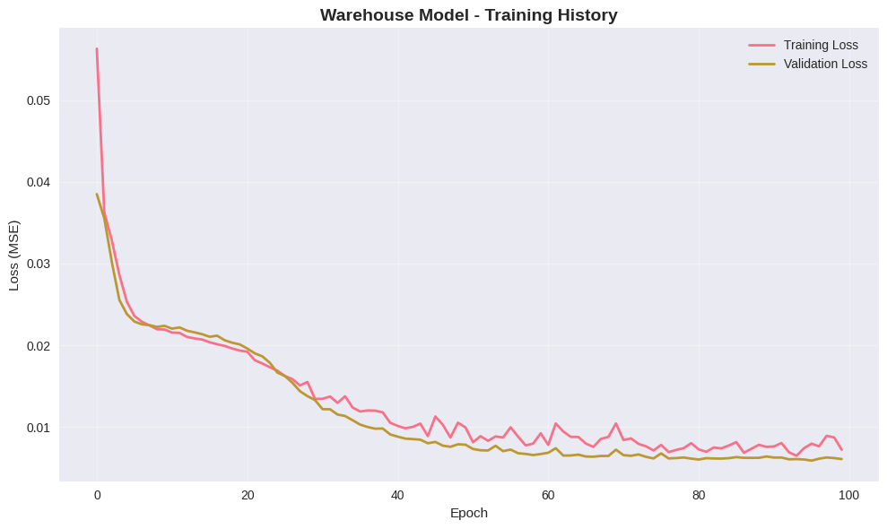

<p align="center">
  
</p>

# SynapseSupply

Built as a team project at the BUP Hackathon; the original repository is [Suprio85/SynapseSupply](https://github.com/Suprio85/SynapseSupply).

Retail outlets in Bangladesh run out of stock during Eid and sit on excess stock in the monsoon, while the central warehouse has to decide how to split limited supply between them. SynapseSupply is a pipeline for that decision. It forecasts each outlet's demand for the next seven days, estimates what the warehouse can realistically supply, and defines the PostgreSQL schema that allocation requests and decisions are recorded in.

The forecasting models and the database layer are working. The negotiation agents and the allocation optimizer that will sit on top of them are the next piece (see [Status](#status)).

## Results

Both models were trained in [`backend/notebooks/demand_forecasting.ipynb`](backend/notebooks/demand_forecasting.ipynb) on a random 70 / 10 / 20 train / validation / test split. The figures below are from the held-out test set.

| Model | Target | R² | MAE |
|---|---|---|---|
| Outlet demand | units demanded over the next 7 days | 0.853 | 98.9 |
| Warehouse | optimal inventory level | 0.884 | 3,087 |
| Warehouse | feasible maximum supply | 0.884 | 1,269 |

The data is synthetic (see below), so these numbers show that the pipeline learns the structure it was given. They are not a claim about accuracy on real sales.

<p align="center">
  
  
</p>

## How it works

**Data.** Real outlet-level sales for Bangladesh are hard to get, so [`supply_chain_data_generator.py`](backend/utils/supply_chain_data_generator.py) builds a three-year daily dataset (2022 to 2024): 30 outlets across 8 regions and 5 outlet types, 10 product lines, and one central warehouse. Demand depends on product seasonality, the six Bengali seasons, region and outlet size, weekends (Friday and Saturday), and events: Eid, Ramadan, hartal, heavy monsoon and load-shedding. The warehouse table adds inbound shipments, supplier reliability and lead time, disruption and transport indices, and storage limits. It produces 328,800 outlet rows and 10,960 warehouse rows.

**Outlet model.** A four-layer network with batch norm and dropout predicts `next_7_days_demand` from 26 features: 12 numeric ones (including cyclical month and weekday encodings), 7 label-encoded categoricals, and the target-mean encoding of each of those 7. The target is square-root transformed and min-max scaled, and the extreme 1% tails are trimmed before training.

**Warehouse model.** A shared two-layer trunk feeds two heads, one for `optimal_inventory_level` and one for `feasible_max_supply`, trained jointly on 27 features.

**Training.** MSE loss, Adam with weight decay, a plateau-based learning-rate schedule and early stopping on validation loss.

**Database.** [`Schema.sql`](backend/db/Schema.sql) defines the PostgreSQL schema: static and dated warehouse state, outlets, products, allocation requests with per-product line items, and an `allocations` table that keeps the transport cost, lead time and a JSONB `negotiation_log` for each decision. [`query.py`](backend/db/query.py) reads tables in pages through the Supabase client, joins them into the training-CSV format, and handles inserts and filtered updates.

## Status

| Area | State |
|---|---|
| Synthetic data generator | Done |
| Outlet and warehouse forecasting models | Done, evaluated on a held-out split |
| PostgreSQL schema and Supabase access layer | Done |
| Outlet and warehouse agents (LangGraph) | Next |
| Allocation optimizer (PuLP) | Next |
| API and dashboard | Later |

The allocation request and decision tables are already in the schema, so the agent layer has somewhere to write from day one.

## Repository layout

```
.
├── docs/                         architecture diagram and training plots
└── backend/
    ├── db/
    │   ├── Schema.sql            PostgreSQL schema
    │   ├── connect.py            Supabase client from environment variables
    │   └── query.py              paginated reads, CSV export, insert and update helpers
    ├── notebooks/
    │   └── demand_forecasting.ipynb   preprocessing, both models, evaluation, sample predictions
    ├── utils/
    │   └── supply_chain_data_generator.py   synthetic data CLI
    ├── agents/                   reserved for the agent layer
    ├── main.py                   `check` and `export` commands
    └── requirements*.txt
```

## Running it

You need Python 3.10 or newer. A CUDA GPU is optional.

**Train the models**

```bash
cd backend
python -m venv venv && source venv/bin/activate
pip install -r requirements-ml.txt
jupyter notebook notebooks/demand_forecasting.ipynb
```

Run all cells. The notebook generates the two CSVs itself, so no download is needed. To generate them without the notebook:

```bash
python utils/supply_chain_data_generator.py --out-dir .
```

**Connect the database**

1. Create a Supabase project and run `backend/db/Schema.sql` in its SQL editor.
2. Copy `backend/.env.example` to `backend/.env` and fill in `SUPABASE_URL` and `SUPABASE_KEY`.
3. From `backend/`, run `python main.py check` to test the connection, or `python main.py export` to write `bd_outlet_extended.csv` and `bd_warehouse_extended.csv` from the stored tables.

## Stack

PyTorch, scikit-learn, pandas and NumPy for the models; PostgreSQL on Supabase for storage; LangGraph and PuLP for the coordination layer.

## Team

Built by a team at the BUP Hackathon.

- **Suprio Paul** ([@Suprio85](https://github.com/Suprio85)): original author. Started the repository and wrote the PostgreSQL schema, the Supabase access layer and the project structure.
- **[@Morningstaaar36](https://github.com/Morningstaaar36)**: data generator and the outlet and warehouse forecasting models in the notebook.
